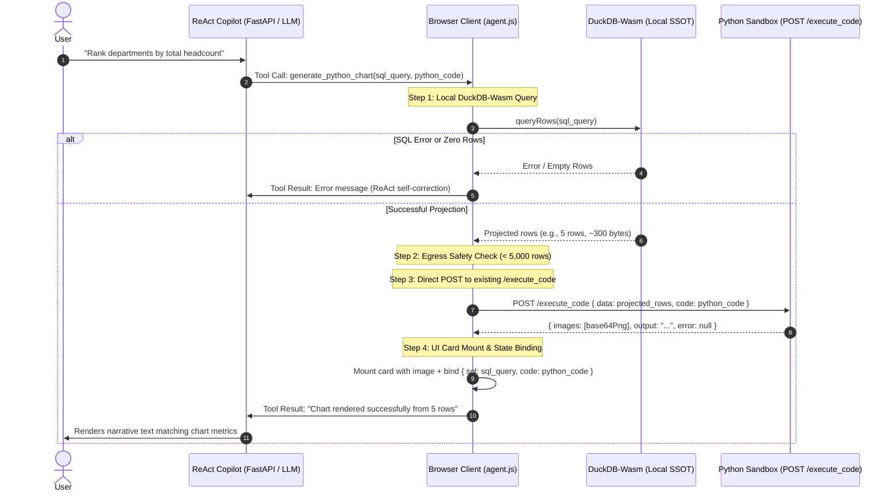

# RFC: SQL-First Minimal-Egress Visualization Architecture (`generate_python_chart`)

* **Author:** Mats Schneider
* **Date:** 2026-11-03
* **Status:** Brainstorming Consolidated RFC (Ready for Design Draft / Implementation)

---

## 1. Problem Statement & Objectives

### The Core Problem
Dataviz-Agent maintains two execution engines: client-side DuckDB-Wasm (the authoritative Single Source of Truth for 100% of data) and a stateless backend Python sandbox (Matplotlib/Seaborn for narrative publication charts). 

Previously, the frontend truncated chat requests to 50 rows (`data.slice(0, 50)`). This caused a severe data split:
- Text summaries and takeaway titles generated from DuckDB-Wasm reported exact metrics calculated over the complete dataset (e.g., Sales: 516 headcount across 250 rows).
- Python charts plotted only the 50-row preview sample, displaying conflicting values (e.g., Sales: ~100 headcount).

Attempting to fix this by streaming full raw datasets over HTTP to Python introduces critical architectural failure modes:
1. **Payload Bloat & Latency:** Uploading 10 MB–50 MB CSVs on every chat turn adds 1.5s–6.0s network latency.
2. **Gateway Caps:** Exceeds standard reverse proxy and ingress limits (e.g., Nginx default `client_max_body_size 1M`, AWS API Gateway `10M`), triggering `413 Payload Too Large`.
3. **Data Privacy Egress:** Transmitting complete raw tables exposes unneeded columns and PII across the network.
4. **Static Disconnect:** Unlike interactive Vega-Lite, Seaborn produces flat PNGs that break when user code edits assume raw rather than projected data.

### Objectives
1. **100% Value Parity:** Ensure chart bar lengths, labels, and titles perfectly match DuckDB-Wasm metrics.
2. **Minimal-Egress Transfer:** Transmit only aggregated/projected query rows (< 10 KB) over HTTP, never raw multi-megabyte datasets.
3. **Single-Turn Latency:** Execute SQL projection and Python plotting in one atomic LLM action, avoiding multi-turn ReAct roundtrips.
4. **Reproducible & Editable Code:** Support in-chat code editing ("Run Code") and self-contained Jupyter notebook export.

---

## 2. Target Architecture & Execution Flow

### Atomic Tool Contract: `generate_python_chart`

We introduce an atomic, client-delegated tool that couples SQL projection with Python plotting:

```json
{
  "name": "generate_python_chart",
  "description": "Generates a publication-quality Seaborn/Matplotlib chart by first querying the full dataset in DuckDB-Wasm, then plotting the projected rows in Python.",
  "parameters": {
    "type": "object",
    "properties": {
      "sql_query": {
        "type": "string",
        "description": "DuckDB SQL query targeting table 'dataset' to extract and aggregate the exact rows/columns needed for the chart."
      },
      "python_code": {
        "type": "string",
        "description": "Python plotting code using seaborn (sns) and matplotlib.pyplot (plt) with VK_* layout helpers. Plotted data is available in DataFrame 'df'."
      }
    },
    "required": ["sql_query", "python_code"]
  }
}
```

### End-to-End Sequence



---

## 3. Subsystem Modifications & Contracts

### 1. Browser Client (`static/js/agent.js`)
* **Tool Delegation:** Add `generate_python_chart` to client-handled tools in `handleSend()`.
* **Execution Pipeline:**
  1. Execute `sql_query` against `window.duckdbEngine.queryRows(callArgs.sql_query)`.
  2. Guardrail check: if projected rows exceed `5,000` rows, reject with `Observation: Projection exceeded 5,000 rows. Please add SQL aggregation or LIMIT.`
  3. POST projected rows + `python_code` to the existing `POST /execute_code` endpoint.
  4. Capture the returned Base64 PNG and store `{ sql: callArgs.sql_query, code: callArgs.python_code }` in card metadata.
* **"Run Code" Interactive Card Editing:**
  - Update `setupPlotCard()`: When the user edits code and clicks "Run Code", the client retrieves the card's `sql`, re-queries DuckDB-Wasm locally to ensure `df` has the expected schema, and sends the updated code + data to `/execute_code`.
* **"Copy Code" Export for Jupyter Notebooks:**
  - The copy button exports a self-contained script prepending the DuckDB extraction:
    ```python
    import duckdb
    import pandas as pd
    import seaborn as sns
    import matplotlib.pyplot as plt

    # Query active dataset via DuckDB
    con = duckdb.connect()
    # con.register('dataset', raw_df)
    df = con.execute("""<sql_query>""").df()

    # Plotting code
    <python_code>
    plt.show()
    ```

### 2. Backend Agent (`src/agent.py` & `src/tools.py`)
* **Tool Registration:**
  - Register `generate_python_chart` in `CLIENT_DELEGATED_TOOLS` and `OPENAI_TOOLS`.
  - Deprecate `execute_python_code` from the LLM prompt tool list during chat turns, keeping it active as a server fallback.
* **Prompt Instructions:**
  - Direct the agent:
    - Pure analytical queries & metrics -> `execute_sql`
    - Column derivations -> `propose_column`
    - Publication charts -> `generate_python_chart`
* **Backend Endpoint Reuse:**
  - Reuse the existing `@app.post("/execute_code")` in `src/main.py`. No redundant `/execute_chart` route is created.

### 3. Device & Mobile Strategy
* **Uniform Lightweight Rendering:** The server-generated Base64 PNG is ~40 KB, which consumes significantly less volatile RAM on mobile devices (iOS Safari) than running heavy in-browser WebAssembly visualization engines.
* **Responsive Layout:** The generated PNG renders responsively within the mobile chat drawer without fragile prompt branching on screen width. Users wanting declarative exploration can use the existing Vega / Graphic-Walker tabs.

---

## 4. Alternatives Considered & Rejected

| Alternative | Mechanics | Reason for Rejection |
| :--- | :--- | :--- |
| **A. Raw Full-Dataset Streaming** | POST entire dataset (up to 50k rows) in JSON on every chat turn. | **Rejected**: Triggers HTTP `413 Payload Too Large` on standard ingress gateways, multiplies network latency by 10x–50x, and causes client main-thread serialization jitter. |
| **B. Client-Side Pyodide WebAssembly** | Run Python, Matplotlib, and Seaborn in-browser via WebAssembly. | **Rejected**: Requires 30 MB+ initial asset download, 3–5s initialization delay, and consumes 200 MB–300 MB RAM, causing immediate tab termination on mobile browsers. |
| **C. Universal Vega-Lite (Retire Seaborn)** | Replace Python plotting entirely with in-browser Vega-Lite JSON specs. | **Rejected**: Fails user requirement for narrative layout discipline (`VK_*` bold takeaway titles, unit subtitles, driver accent highlighting) and breaks direct copy-paste export into Jupyter Notebook workflows. |
| **D. Viewport-Coupled LLM Branching** | Instruct the LLM to generate Vega on screens < 768px and Seaborn on desktop. | **Rejected**: Couples transient CSS viewport width into agent system prompts, introduces dual prompt/test maintenance, and breaks cross-device chat sync. |

---

## 5. Risks & Mitigations

| Risk | Impact | Mitigation |
| :--- | :--- | :--- |
| **Unbounded Projection (`SELECT *`)** | LLM generates unaggregated query, streaming large data over network. | Hard client-side cap: `rows.length > 5000` aborts network dispatch and returns an error observation instructing the agent to aggregate. |
| **SQL Column Alias Mismatch** | Python code expects `df['headcount']` but SQL named column `total`. | Python `KeyError` traceback is captured by `/execute_code` and returned to the agent for automated ReAct self-correction. |
| **Interactive Card Code Invalidation** | User edits Python code in card, but `df` lacks projected columns. | Card metadata stores `{ sql, code }`; clicking "Run Code" re-runs the SQL query against DuckDB-Wasm before posting to Python. |
| **Backend Execution Security (RCE)** | Execution of arbitrary Python code in `/execute_code`. | AST linter checks (`src/vizkit/linter.py`), process timeout (5s), and execution in a dedicated sandboxed scope without network/file access. |

---

## 6. Handoff & Implementation Phases

* **Phase 1: Tool Schema & Backend Support:** Register `generate_python_chart` in `src/tools.py` and `src/agent.py`. Preserve `/execute_code` in `src/main.py`.
* **Phase 2: Client-Side Execution Pipeline:** Implement `generate_python_chart` handler in `static/js/agent.js` with local DuckDB execution, egress guardrails (< 5,000 rows), and `/execute_code` dispatch.
* **Phase 3: Card State & Lifecycle:** Update `chat-plot-card` metadata to persist `{ sql, code }`, wire `setupPlotCard` re-query logic, and add runnable Jupyter script export.
* **Phase 4: Automated Verification:** Test endpoint with synthetic projected payloads and verify zero-discrepancy end-to-end rendering.
