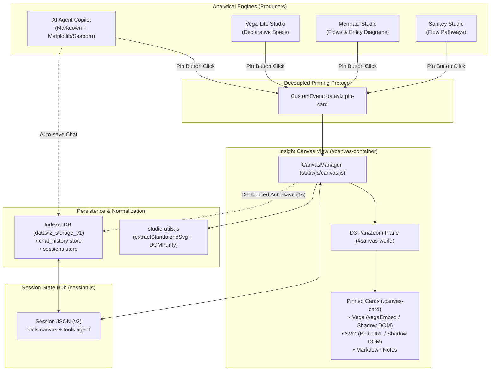

# Insight Canvas & Workspace Persistence MVP

* **Author:** Mats Schneider
* **Status:** Draft
* **Date:** 2026-11-03

--------------------------------------------------------------------------------

## Overview

Dataviz-Agent is an open-source, local-first visual analytics suite that pairs browser-native data visualization engines (LineUp, Graphic-Walker, SandDance, Vega-Lite, Sankey, Mermaid) with a sandboxed ReAct AI agent. 

While the platform allows users to explore data and generate plots conversationally, analytical findings currently remain ephemeral and isolated across disparate tool tabs. When users switch datasets or reload their browser, their analytical reasoning and intermediate visual discoveries are lost.

The **Insight Canvas & Workspace Persistence** feature introduces:
1. **A dedicated Freeform Spatial Canvas tab** where users accumulate, position, and curate analytical artifacts (AI summaries, Vega-Lite charts, Mermaid diagrams, and Sankey flows) alongside markdown annotations.
2. **One-click "Pin to Canvas" triggers** across the Agent Copilot chat and Studio control sidebars.
3. **Robust browser persistence via IndexedDB**, replacing unreliable `localStorage` caching to prevent silent context and chat history truncation.
4. **Session v2 format integration**, enabling offline workspace export and restoration without external database dependencies.

---

## The Problem

1. **Fragmented Insight Discovery:** Users can generate charts in Vega Studio, extract relational workflows in Mermaid, inspect flows in Sankey, or query the AI Agent, but they have no central workspace to collect and synthesize these disparate findings into a coherent analytical narrative.
2. **Ephemeral Context & Data Loss:** Active chat history is currently cached in `localStorage` under key `ai_agent_chat_history_v1`. Because Matplotlib/Seaborn plots produce base64 image strings, extended sessions rapidly exceed the 5 MB browser quota. When `QuotaExceededError` occurs, the current code silently purges all but the last 5 messages, destroying user context.
3. **Linear Rigidity:** Analytical stories are multi-dimensional. Forcing findings into vertical lists fails to utilize widescreen displays and prevents spatial grouping of related hypotheses and metrics.

---

## Goals

* **G1: Dedicated Canvas View:** Introduce an `#canvas-container` tab and `#show-canvas-btn` navigation button integrated into Dataviz-Agent's view lifecycle.
* **G2: Battle-Tested Spatial Navigation:** Implement pan, zoom, and card dragging on an infinite 2D plane by reusing the globally loaded `d3.zoom()` and `d3.drag()` engines (zero new runtime dependencies).
* **G3: Decoupled One-Click Pinning:** Establish a global `dataviz:pin-card` DOM event protocol allowing Agent chat cards and Studio sidebars (Vega, Mermaid, Sankey) to pin findings instantly with visual confirmation.
* **G4: Self-Contained Card Rendering:** Render pinned Vega charts via compact declarative specifications (~2 KB), and Mermaid/Sankey/Matplotlib cards via standalone sanitized SVGs with inlined CSS styles and shadow DOM isolation.
* **G5: Quota-Resilient Storage:** Replace `localStorage` chat caching with an asynchronous IndexedDB adapter (`static/js/storage-db.js`) supporting multiple sessions and large plot payloads without truncation.
* **G6: Unified Session Export:** Upgrade the session JSON format to version 2 (`SESSION_VERSION = 2`) with `tools.canvas`. Alpha stage: no legacy backward-compatibility shims required.

---

## Non-Goals

* **NG1: Graphic-Walker & SandDance Pinning (v1):** Extracting views from Graphic-Walker and SandDance is excluded from MVP due to proprietary state encodings and 3D WebGL rendering boundaries.
* **NG2: Live In-Card Interactivity:** Canvas cards will not host live, interactive data-query runtimes or full code editors. Interactive manipulation is handled via "Open in Studio" navigation.
* **NG3: Real-Time Multi-User Collaboration:** No WebSockets, peer-to-peer WebRTC, or CRDT synchronization (e.g., Yjs). Dataviz-Agent remains strictly local-first and client-side.
* **NG4: Vector Connectors & Mindmap Edges:** Spatial card positioning and auto-grid arrangement are in scope; drawing arrows and relational edge lines between cards is deferred to v2.
* **NG5: Cloud Storage & Multi-Tenant Backends:** Cloud connectors (Google Drive, OneDrive) and user account databases are out of scope. Persistence relies solely on browser IndexedDB and JSON file export/import.

---

## Open Questions

* **OQ1: Multi-Dataset Canvas Coexistence:** When a user uploads a new dataset during an active session, should previously pinned cards remain visible with a "Historical Dataset" badge, or should users be prompted to clear the canvas? *(Proposed resolution: Keep cards visible with dataset provenance badges, but disable "Open in Studio" if source data columns mismatch).*
* **OQ2: Auto-Layout Behavior:** What default coordinate placement should be assigned to newly pinned cards? *(Proposed resolution: Place new cards at the next open slot in a virtual 3-column grid starting near viewport center, avoiding card overlap).*

---

## Critical User Journeys (CUJs)

### CUJ 1: Pinning an Agent Statistical Finding & Chart to Canvas
* **Given:** The user has loaded `sales_q3.csv` and asked the AI Agent to identify regional outliers. The Agent returns a summary and a Seaborn boxplot.
* **When:** The user hovers over the Agent response bubble and clicks the top-right "Pin" icon (or clicks "Pin" on the chart action bar).
* **Then:** A brief toast confirms `"Pinned to Canvas"`, the Canvas tab counter increments (`Canvas (1)`), and an immutable card containing the markdown summary and plot is placed onto the canvas plane.

### CUJ 2: Assembling a Storyboard & Arranging Spatially
* **Given:** The user has pinned 2 Agent insights, 1 Vega-Lite trend chart from Vega Studio, and 1 Mermaid process diagram.
* **When:** The user switches to the Canvas tab, drags cards into logical clusters (e.g., "North Region Problem" on the left, "Proposed Workflow" on the right), adds a freeform Markdown note card (`➕ Note`), and clicks `Tidy Grid`.
* **Then:** Cards snap smoothly to aligned coordinates. The user can pan and zoom across the board using mouse wheel and drag gestures.

### CUJ 3: Exporting, Reloading, and Resuming Session State
* **Given:** The user has an active canvas with 4 cards and 15 turns of AI chat history.
* **When:** The user refreshes the browser tab or clicks "Export Session (.json)" from the Workspace menu and reloads the `.json` file days later.
* **Then:** The workspace rehydrates from IndexedDB (or imported JSON): all 4 canvas cards reappear at their exact spatial coordinates, the active dataset is restored, and the full un-truncated chat history is re-rendered in the Agent sidebar.


---

## Technical Plan (Architecture)

### 1. System Topology & Data Flow



---

### 2. Component Architecture & Responsibilities

#### A. CanvasManager (`static/js/canvas.js`)
* **Role:** Manages the lifecycle, DOM nodes, drag/pan/zoom transforms, and state serialization of the canvas plane.
* **Key Methods:**
  * `constructor({ container, onOpenVega, onOpenMermaid })`: Initializes DOM container `#canvas-container`, inner `#canvas-world`, and floating `#canvas-control-dock`.
  * `initD3Zoom()`: Binds `d3.zoom().scaleExtent([0.15, 3.0])` to the container and applies `translate3d(x, y, 0) scale(k)` to `#canvas-world`.
  * `initCardDrag(cardEl, cardData)`: Uses `d3.drag()` with coordinate division (`dx / currentScale`, `dy / currentScale`) and pointer capture to allow card dragging without pointer drift.
  * `addCard(cardDetail)`: Normalizes payload, assigns unique ID, calculates placement coordinates, appends DOM card, and increments the `#canvas-card-count` badge.
  * `tidyGrid()`: Smoothly animates cards into a responsive 3-column grid sorted by creation timestamp.
  * `fitAll()`: Calculates bounding box of all cards and smoothly transitions `d3.zoom()` viewport to fit all cards with 40px padding.
  * `exportState()`: Returns serializable `{ version: 1, viewport: { panX, panY, zoom }, cards: [...] }`.
  * `importState(state)`: Clears existing DOM nodes, rehydrates cards, and restores viewport coordinates.

#### B. Storage Database Adapter (`static/js/storage-db.js`)
* **Role:** Lightweight asynchronous IndexedDB wrapper (`dataviz_storage_v1`) replacing synchronous `localStorage`.
* **Database Stores:**
  * `chat_history`: Keyed by session/dataset ID. Stores full array of agent turns, code snippets, and image data URLs without size truncation.
  * `sessions`: Stores active workspace dumps (canvas state, active tab, tool dumps, and dataset schema).
* **Migration Safeguard:** On startup, detects existing `ai_agent_chat_history_v1` in `localStorage`, migrates records to IndexedDB, and safely removes the legacy key.

#### C. Standalone SVG Extractor & Normalizer (`static/js/studio-utils.js`)
* **Role:** Isolates SVGs from the host DOM to prevent black silhouettes and CSS bleed.
* **Mechanism (`extractStandaloneSvg(svgElement)`):**
  1. Clones the target SVG node deeply.
  2. Traverses child nodes and inlines computed CSS properties (`fill`, `stroke`, `stroke-width`, `font-family`, `font-size`) calculated via `window.getComputedStyle()`.
  3. Computes bounding box via `svgElement.getBBox()` and normalizes `viewBox`, `width`, and `height`.
  4. Ensures `xmlns="http://www.w3.org/2000/svg"` is explicitly set on the root `<svg>`.
  5. Sanitizes through DOMPurify (`DOMPurify.sanitize(svgString, { USE_PROFILES: { svg: true } })`).

---

### 3. Decoupled Pinning Event Protocol

Any visualizer or agent bubble pins artifacts to the canvas by dispatching the `dataviz:pin-card` custom event on `window`:

```javascript
window.dispatchEvent(new CustomEvent('dataviz:pin-card', {
    detail: {
        type: 'vega' | 'mermaid' | 'sankey' | 'plot' | 'markdown',
        title: 'Q3 Revenue Outliers',
        payload: {
            spec: { ... },              // Declarative Vega-Lite spec (for vega cards)
            code: 'flowchart LR...',    // Mermaid source string (for mermaid cards)
            svgString: '<svg>...</svg>', // Clean inlined SVG (for sankey/plot cards)
            content: '# Executive Memo' // Raw markdown (for note/agent cards)
        },
        source: {
            origin: 'agent' | 'vega' | 'mermaid' | 'sankey' | 'user',
            datasetName: 'sales_q3.csv',
            timestamp: Date.now()
        }
    }
}));
```

---

### 4. Card Isolation & Rendering Mechanics

To prevent SVG ID collisions (`<clipPath id="clip-1">`, gradients, arrow markers) and CSS font collisions:
1. **Vega Cards:** Pinned with compact JSON spec (~2 KB). Rendered inside an isolated DOM container using `vegaEmbed(cardBodyEl, spec, { actions: false, renderer: 'svg' })`.
2. **Mermaid & Sankey Cards:** Rendered inside a Shadow Root (`cardBodyEl.attachShadow({ mode: 'open' })`) containing an internal stylesheet resetting margins, or rendered via an `` tag pointing to `URL.createObjectURL(new Blob([svgString], { type: 'image/svg+xml' }))`.
3. **Agent & Note Cards:** Rendered using the existing `marked.parse()` and `DOMPurify.sanitize()` pipeline, styled with `.markdown-content`.

---

### 5. Session Schema Integration (v2)

`static/js/session.js` bumps `SESSION_VERSION` from `1` to `2`.

```json
{
  "format": "dataviz-agent-session",
  "version": 2,
  "exportedAt": "2026-11-03T12:00:00.000Z",
  "activeView": "canvas",
  "datasetSchema": {
    "name": "sales_q3.csv",
    "rowCount": 1420,
    "columnCount": 12,
    "columns": ["region", "revenue", "cost", "date"]
  },
  "tools": {
    "lineup": { "dump": {} },
    "graphicWalker": null,
    "sanddance": null,
    "sankey": null,
    "mermaid": null,
    "vega": null,
    "agent": {
      "history": [...],
      "activeSkills": [...]
    },
    "canvas": {
      "version": 1,
      "viewport": { "panX": 0, "panY": 0, "zoom": 1.0 },
      "cards": [
        {
          "id": "card-1730635200-1",
          "type": "vega",
          "title": "Revenue Trend by Region",
          "x": 80,
          "y": 100,
          "width": 460,
          "height": 320,
          "zIndex": 1,
          "source": {
            "origin": "vega",
            "datasetName": "sales_q3.csv",
            "timestamp": 1730635200000
          },
          "payload": {
            "spec": { "$schema": "https://vega.github.io/schema/vega-lite/v5.json", "mark": "bar" }
          }
        }
      ]
    }
  }
}
```


---

## Alternatives Considered

### Alternative A: Storyboard / Masonry Grid Layout (Linear / Fixed Grid)
* **Description:** A purely vertical or 12-column responsive grid where cards stack sequentially, with native browser scroll and no 2D pan/zoom.
* **Pros:** Zero coordinate translation math; avoids CSS transform scaling quirks; easy PDF/HTML export.
* **Cons:** Lacks spatial grouping; fails to utilize wide displays for non-linear storytelling.
* **Reason for Rejection:** Rejected by author: Data storytelling across diverse hypotheses requires a freeform spatial layout where users can cluster related metrics side-by-side.

### Alternative B: HTML5 Pixel Canvas (Konva.js / Pixi.js)
* **Description:** Rendering cards directly onto an HTML5 `<canvas>` element using a 2D scene graph library.
* **Pros:** Handles thousands of objects with high rendering frame rates.
* **Cons:** Pinned Vega charts cannot be rendered declaratively or scaled as vector SVGs; markdown notes cannot support native text selection, copy-paste, or rich DOM elements.
* **Reason for Rejection:** Rejected by author: Preserving vector chart clarity and native markdown typography requires DOM elements with CSS transforms.

### Alternative C: LocalStorage Binary Compression (LZ-String)
* **Description:** Compressing base64 image strings and canvas JSON into `localStorage` using LZ-based algorithms.
* **Pros:** Avoids introducing an asynchronous database API.
* **Cons:** Only postpones quota exhaustion; synchronous compression freezes the main UI thread during typing and dragging.
* **Reason for Rejection:** Rejected by author: IndexedDB provides true asynchronous multi-megabyte storage capacity and eliminates the need for destructive chat truncation.

---

## Detailed Implementation Plan

### File Modification Inventory

1. **`static/js/storage-db.js` (NEW)**
   * *Rationale:* Lightweight asynchronous IndexedDB adapter (`dataviz_storage_v1`) managing `chat_history` and `sessions` stores, with one-time migration from legacy `localStorage`.

2. **`static/js/studio-utils.js` (MODIFIED)**
   * *Rationale:* Add `extractStandaloneSvg(svgElement)` helper that deeply clones an SVG, inlines computed typography and colors, normalizes `viewBox` from `getBBox()`, and sanitizes output via DOMPurify.

3. **`static/js/canvas.js` (NEW)**
   * *Rationale:* Implements `CanvasManager` class:
     * D3 zoom/pan binding on `#canvas-container` and `#canvas-world`.
     * Card drag physics via `d3.drag()` with coordinate-space scale translation (`dx / scale`).
     * Card DOM creation, header dragging, editable titles, and "Open in Studio" navigation.
     * `addCard()`, `tidyGrid()`, `fitAll()`, `exportState()`, and `importState()`.
     * Listener for `dataviz:pin-card` custom event.

4. **`static/index.html` (MODIFIED)**
   * *Rationale:*
     * Add `#show-canvas-btn` to `#view-controls` in header bar.
     * Add `#canvas-container` with inner `#canvas-world` and `#canvas-control-dock`.
     * Add "Pin to Canvas" action buttons to Vega Studio (`#vega-pin-canvas-btn`), Mermaid Studio (`#mermaid-pin-canvas-btn`), and Sankey Studio (`#sankey-pin-canvas-btn`).

5. **`static/style.css` (MODIFIED)**
   * *Rationale:*
     * Add layout rules for `#canvas-container`, `#canvas-world`, and dot-matrix background pattern.
     * Add `.canvas-card`, `.canvas-card-header`, `.canvas-card-body`, and drag states.
     * Add `.chat-msg-pin-btn` hover button on `.message.agent` and `.chat-pin-chart-btn`.
     * Add `#canvas-control-dock` floating toolbar styling matching `.sidebars-controls-pill`.

6. **`static/js/agent.js` (MODIFIED)**
   * *Rationale:*
     * Replace `localStorage` calls in `saveChatHistory()` and `getChatHistory()` with asynchronous `storage-db.js` IndexedDB methods.
     * Add pin action button on hover of assistant message bubbles.
     * Add `Pin` button to inline chart cards (Vega, Plot, Mermaid) dispatching `dataviz:pin-card`.

7. **`static/js/session.js` (MODIFIED)**
   * *Rationale:*
     * Bump `SESSION_VERSION` to `2`.
     * Add `tools.canvas = managers.canvas?.exportState()` in `exportSession`.
     * Add `managers.canvas.importState(tools.canvas)` in `restoreSessionState`.

8. **`static/main.js` (MODIFIED)**
   * *Rationale:*
     * Import `CanvasManager` and instantiate it with visualizer callbacks.
     * Register `canvasContainer` in `visualContainers` and `showCanvasBtn` in `visualViewButtons`.
     * Wire `showCanvas()` and add `'canvas'` case to `activateViewByName()`.

---

## Testing, Observability & Rollout

### Test Matrix
1. **D3 Zoom/Drag Verification:**
   * Test pan, zoom-in, zoom-out, and reset via wheel, touch gestures, and toolbar buttons.
   * Verify card dragging operates without drift across various zoom levels (0.2x to 3.0x).
2. **Pinning Reliability:**
   * Pin Vega-Lite chart from Vega Studio -> Verify card renders vector chart cleanly.
   * Pin Mermaid diagram -> Verify card displays diagram with inlined colors and typography (no black silhouettes).
   * Pin Sankey diagram -> Verify node colors and link paths match active studio.
   * Pin Agent answer with embedded Matplotlib PNG -> Verify markdown and plot image render cleanly.
   * Click "Open in Studio" on a pinned Vega card -> Verify Vega Studio opens with matching spec.
3. **Storage & Quota Stress Testing:**
   * Generate 20+ chat turns with embedded plots -> Verify IndexedDB persists all turns without truncation.
   * Verify browser page reload cleanly rehydrates canvas cards and agent conversation history.
4. **Session Export/Import Roundtrip:**
   * Export active workspace to `.json` file.
   * Reset workspace and reload exported `.json` -> Verify canvas cards and coordinates restore 1:1.
