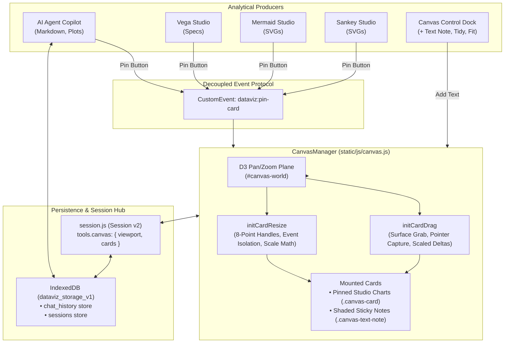

# Insight Canvas & Workspace Persistence Specification

* **Author:** Mats Schneider
* **Status:** Finalized
* **Date:** 2026-11-03

--------------------------------------------------------------------------------

## Overview

Dataviz-Agent is an open-source, local-first visual analytics suite combining browser-native visualization engines (LineUp, Graphic-Walker, SandDance, Vega-Lite, Sankey, Mermaid) with an integrated ReAct AI copilot.

While users can discover patterns and generate plots interactively, analytical findings remain isolated within specific studio tabs and ephemeral across page reloads.

The **Insight Canvas & Workspace Persistence** engine introduces:
1. **A Freeform Spatial Canvas tab (`#canvas-container`)** allowing users to pin analytical artifacts (Vega-Lite specs, Mermaid diagrams, Sankey flows, and AI responses), organize them spatially on an infinite 2D plane, and add persistent notes.
2. **Native Shaded Sticky Notes (Obsidian-Style)** for clear markdown annotations without awkward detached floating bars or UI flicker. Notes are grabbed and dragged anywhere on their surface and edited by clicking directly into the text.
3. **8-Point Spatial Resizing Architecture** featuring isolated, pointer-captured hit zones at all 4 corners and all 4 edges with directional cursors, scale-normalized coordinate math, and zero D3 canvas viewport drift.
4. **Decoupled Pinning Protocol** (`dataviz:pin-card` DOM events) connecting studios and the AI agent chat to the canvas.
5. **IndexedDB Session & Multi-Chat Persistence** via `static/js/storage-db.js`, eliminating `localStorage` quota errors and enabling session switching.

---

## The Problem

1. **Fragmented Findings & Rigid Organization:** Visualizations and AI insights exist in separate silos. Users cannot place a Mermaid process diagram next to a Vega distribution chart and a textual summary to synthesize an analytical story.
2. **Text Note UI Friction & Detached Controls:** The current freeform text note implementation places drag and delete controls in an unstyled floating bar positioned outside the element boundary (`top: -26px`). This produces hover flicker, lacks visual alignment with Dataviz-Agent's design system (`--c-raised`, `--c-border`, `.card-action-btn`), and restricts dragging to an awkward 12px grip icon.
3. **Broken Spatial Resizing (Canvas Pan Trap):** The current size changer relies on native CSS `resize: both` on the inline textarea. When users drag the resize corner, pointer events bubble directly to `#canvas-container`, triggering D3 zoom panning rather than card resizing. Furthermore, cards lack comprehensive edge/corner resize affordances.
4. **Ephemeral Storage & 5MB LocalStorage Cap:** Pinned plots and chat messages containing base64 images exceed browser `localStorage` limits, causing silent history truncation and data loss.
5. **Session Incoherence on Dataset Reset:** Resetting a dataset previously left stale canvas cards active in memory without clearing state or alerting the user of data loss.

---

## Goals

* **G1: Native Shaded Sticky Notes (Obsidian-Style):** Style text notes as shaded sticky containers (`--c-raised`, `--r-md`, `--c-border`, `--shadow-sm`). Grabbing anywhere on the note surface repositions it. Clicking directly into the text enters markdown editing. A clean delete button (`.delete-card-btn`) fades in smoothly at the top-right corner on hover.
* **G2: 8-Point Spatial Resizing Engine:** Implement isolated, pointer-captured hit zones across all 4 corners and all 4 edges of cards and text notes. Halt event propagation (`e.stopPropagation()`) to isolate D3 zoom, divide deltas by `currentScale`, anchor opposing edges, and enforce strict min/max dimension boundaries.
* **G3: Dedicated Spatial Canvas View:** Integrate `#canvas-container` and `#show-canvas-btn` into the application view lifecycle with D3-powered pan, zoom, tidy grid, and fit-all.
* **G4: Decoupled One-Click Pinning:** Provide hover and action-bar pin buttons across Agent Chat and Studios (Vega, Mermaid, Sankey) dispatching `dataviz:pin-card`.
* **G5: Self-Contained Spec & Isolated SVG Rendering:** Render Vega cards via declarative specifications, and Mermaid/Sankey cards via isolated Shadow DOM / Blob SVGs with inlined styles.
* **G6: Asynchronous IndexedDB Storage:** Persist full multi-chat histories and canvas session state without size limits or silent truncation.
* **G7: Safe Reset Lifecycle:** Confirm dataset resets with an explanatory modal and cleanly clear canvas cards and viewport.

---

## Non-Goals

* **NG1: Graphic-Walker & SandDance Pinning (v1):** Extraction of 3D WebGL and proprietary state objects is deferred to v2.
* **NG2: Live In-Card Code Execution:** Canvas cards are presentation containers with "Open in Studio" navigation rather than full embedded IDEs.
* **NG3: Real-Time Multi-User Collaboration:** No WebSockets or CRDT synchronization; Dataviz-Agent remains strictly local-first.
* **NG4: Vector Connecting Lines / Mindmap Edges:** Node-link line drawing between cards is deferred to v2.
* **NG5: Cloud Storage Adapters:** No cloud sync services; persistence relies solely on client-side IndexedDB and JSON exports.

---

## Resolved Design Decisions

* **DD1: 8-Point Boundary Resizing:** Every card and note exposes 8 active resize hit zones:
  * Top-Left (`.resize-corner-tl`): `nwse-resize`
  * Top Edge (`.resize-edge-t`): `ns-resize`
  * Top-Right (`.resize-corner-tr`): `nesw-resize`
  * Right Edge (`.resize-edge-r`): `ew-resize`
  * Bottom-Right (`.resize-corner-br`): `nwse-resize`
  * Bottom Edge (`.resize-edge-b`): `ns-resize`
  * Bottom-Left (`.resize-corner-bl`): `nesw-resize`
  * Left Edge (`.resize-edge-l`): `ew-resize`
* **DD2: Minimum & Maximum Card Resize Bounds:** Text notes enforce min width 200px, min height 60px; max width 1200px, max height 1200px. Chart cards enforce min width 320px, min height 200px; max width 1200px, max height 900px.
* **DD3: Auto-Resize Adaptation:** Resizing a Vega card dynamically adjusts container dimensions and triggers responsive layout; SVG cards (Mermaid, Sankey, Matplotlib) configure root `<svg>` with `width="100%"` and `height="100%"` and `preserveAspectRatio="xMidYMid meet"`.
* **DD4: Obsidian Canvas Interaction Paradigm:** Direct grabbing anywhere on the card surface initiates drag. Clicking into notes switches to inline textarea editing; blurring or pressing Escape exits to grab state. Hover-only top-right delete button (`.card-action-btn.delete-card-btn`) fades in on hover.

---

## Critical User Journeys (CUJs)

### CUJ 1: Creating, Editing, and Dragging a Sticky Text Note (Obsidian-Style)
* **Given:** The user has the Canvas view open.
* **When:** The user clicks "Text" in the canvas control dock.
* **Then:** A shaded sticky note (`--c-raised`, `--r-md`, `--c-border`) appears at the viewport center in edit mode. When blurred, hovering anywhere on the note displays a `grab` cursor and dragging moves the note. Clicking directly into the text returns to edit mode. A native close button appears smoothly in the top-right corner only when hovering over the card.

### CUJ 2: 8-Point Resizing via Edge and Corner Hover Cues
* **Given:** A Vega chart card and a sticky text note are mounted on the canvas.
* **When:** The user hovers over any of the 4 corners or 4 edges and drags.
* **Then:** The card dimensions and coordinates adjust smoothly in real-time clamped to min/max bounds. Top/left resizing shifts `x` and `y` while anchoring opposite edges. The canvas viewport remains completely stationary (zero D3 zoom panning). New dimensions and coordinates are saved to the card data model.

### CUJ 3: Assembling and Persisting a Multi-Card Storyboard
* **Given:** The user pins an Agent response, a Vega-Lite chart, and adds 2 sticky text notes, resizing and rearranging them into a report layout.
* **When:** The user reloads the browser tab or exports and re-imports the session JSON.
* **Then:** All cards rehydrate with their exact spatial coordinates, customized widths and heights, and full content intact.

---

## Technical Plan (Architecture)

### 1. System Topology & Data Flow



---

### 2. Component Architecture & Detailed Responsibilities

#### A. Shaded Sticky Note Anatomy (`static/js/canvas.js` & `static/style.css`)
* **Visual Frame:** Text notes are styled as shaded sticky containers using `--c-raised` (#f8fafc) background, `--c-border` (#e2e8f0), `--r-md` (8px border radius), and `--shadow-sm`.
* **Obsidian-Style Direct Grabbing:**
  * No dedicated drag button is required. Hovering over the card body displays `cursor: grab`. Pointerdown on the card surface initiates drag (`cursor: grabbing`) via `initCardDrag`.
  * A native close button (`.card-action-btn.delete-card-btn`) is positioned in the top-right corner. It remains invisible by default and fades in smoothly (`opacity: 1`) strictly on card hover (`.canvas-text-note:hover`) or while focused.
* **Body & Inline Markdown Editing:**
  * In view mode, clicking directly into the text switches the note into edit mode (`.is-editing`), auto-focusing the textarea.
  * In edit mode, text editing and selection work naturally (`cursor: text`). Blurring the textarea or pressing Escape exits edit mode, sanitizes markdown via `DOMPurify` and renders via `marked`, and returns the note to the `grab` state.
  * Browser-native `resize: both` is strictly eliminated from `.text-note-editor` to prevent pointer event leakage.

#### B. 8-Point Edge & Corner Resizing Engine (`CanvasManager.initCardResize`)
* **Directional Resize Hit Zones:**
  * Every card (`.canvas-card` and `.canvas-text-note`) includes 8 dedicated hit zones along borders:
    * Corner Top-Left (`.resize-corner-tl`): `cursor: nwse-resize`
    * Edge Top (`.resize-edge-t`): `cursor: ns-resize`
    * Corner Top-Right (`.resize-corner-tr`): `cursor: nesw-resize`
    * Edge Right (`.resize-edge-r`): `cursor: ew-resize`
    * Corner Bottom-Right (`.resize-corner-br`): `cursor: nwse-resize`
    * Edge Bottom (`.resize-edge-b`): `cursor: ns-resize`
    * Corner Bottom-Left (`.resize-corner-bl`): `cursor: nesw-resize`
    * Edge Left (`.resize-edge-l`): `cursor: ew-resize`
  * Zones show clear directional cursors upon hover without intrusive chrome, matching desktop canvas tools.
* **Pointer Isolation & Capture:**
  * `pointerdown` on any resize handle invokes `e.stopPropagation()` and `e.preventDefault()`, completely isolating the interaction from D3 zoom/pan on `#canvas-container`.
  * Acquires pointer capture (`handle.setPointerCapture(e.pointerId)`).
* **Scale-Normalized Delta Math & Opposite-Edge Anchoring:**
  $$\Delta X = \frac{\text{clientX} - \text{startClientX}}{\text{currentScale}}, \quad \Delta Y = \frac{\text{clientY} - \text{startClientY}}{\text{currentScale}}$$
  * Right edge / Bottom edge resize adjusts width and height:
    $$W = \max(W_{\min}, \min(W_{\max}, \text{startW} + \Delta X)), \quad H = \max(H_{\min}, \min(H_{\max}, \text{startH} + \Delta Y))$$
  * Left edge resize adjusts width and shifts card X coordinate:
    $$W = \max(W_{\min}, \min(W_{\max}, \text{startW} - \Delta X)), \quad X = \text{startX} + (\text{startW} - W)$$
  * Top edge resize adjusts height and shifts card Y coordinate:
    $$H = \max(H_{\min}, \min(H_{\max}, \text{startH} - \Delta Y)), \quad Y = \text{startY} + (\text{startH} - H)$$
* **Enforced Dimension Clamping:**
  * Text notes: min width 200px, min height 60px; max width 1200px, max height 1200px.
  * Chart cards: min width 320px, max width 1200px; min height 200px, max height 900px.
* **Visualizer Auto-Refit:**
  * Card body adapts to new dimensions via CSS flex `flex: 1; overflow: hidden;`.
  * Vega-Lite cards trigger container resize; SVG cards (Mermaid, Sankey, Matplotlib) configure SVG root with `width="100%"` and `height="100%"` and `preserveAspectRatio="xMidYMid meet"`.

#### C. Card Data Model & Session Persistence
* Pinned card records store explicit dimensions:
  ```javascript
  {
    id: "card-text-1730635200000",
    type: "text",
    title: "Key Assumptions",
    x: 420,
    y: 180,
    width: 320,
    height: 160,
    zIndex: 14,
    payload: { content: "### Assumptions\n- Normal distribution across cohorts." },
    source: { origin: "user", timestamp: 1730635200000 }
  }
  ```
* `CanvasManager.exportState()` includes `width` and `height` for every card. `CanvasManager.importState()` restores card `style.width` and `style.height` upon reload.

---

## Alternatives Considered

### Alternative 1: Dedicated Top Grab Ribbon & Floating Drag Handles
* **Description:** Providing an explicit full-width header ribbon or a detached floating hover pill (`top: -26px`) containing grip icons (`fa-grip-vertical`) and action buttons for dragging text notes.
* **Pros:** Explicit visual signifier distinguishing the drag handle from the editable content area.
* **Cons:** Introduces visual noise, causes hover flicker when mousing near borders, and forces users to accurately target a tiny 12px grip icon to reposition notes.
* **Reason for Rejection:** Rejected by author: The Obsidian Canvas interaction paradigm—direct grabbing anywhere on the card surface, immediate click-to-edit for text, and an unobtrusive hover-only close button—offers a dramatically smoother user experience with zero unnecessary chrome.

### Alternative 2: Native Browser CSS `resize: both`
* **Description:** Applying native CSS `resize: both` on textareas or card wrappers.
* **Pros:** Native browser feature requiring zero custom JavaScript event handlers.
* **Cons:** Native browser resize grabbers do not expose accessible pointerdown event hooks to stop event propagation. Pointer events bubble directly to the D3 zoom handler on `#canvas-container`, causing the entire viewport to pan instead of resizing the element. Furthermore, native resizing fails to divide deltas by `currentScale`, producing erratic jumpy movement when the canvas is zoomed.
* **Reason for Rejection:** Rejected by author: Causes catastrophic canvas viewport drift in transformed D3 containers and lacks edge-based resizing.

### Alternative 3: External Canvas Resizing Libraries (e.g., interact.js, Moveable.js)
* **Description:** Bundling an external multi-touch transform library to manage bounding boxes, handles, and aspect ratios.
* **Pros:** Pre-packaged rotation, 8-point handles, and snapping algorithms.
* **Cons:** Introduces 40–80 KB of external third-party script bloat, creates matrix math collisions with D3's zoom transform state, and violates the project's minimalist dependency policy.
* **Reason for Rejection:** Rejected by author: Native Pointer Events (`setPointerCapture`), directional CSS cursors, and scale division solve 8-point multi-edge resizing reliably in under 80 lines of vanilla JS with zero external dependencies.

---

## Detailed Implementation Plan

### Unified Implementation Step-by-Step

1. **Step 1: CSS Polish & 8-Point Directional Resize Zones (`static/style.css`)**
   * Transform `.canvas-text-note` into a shaded sticky container with `--c-raised` background, `--c-border`, `--r-md`, and default `cursor: grab`.
   * Implement hover-activated top-right delete button (`.delete-card-btn`) with smooth opacity fade (`opacity: 0` transitioning to `1` on card hover).
   * Eradicate `resize: both` from `.text-note-editor` to permanently halt unstopped pointer bubbling to D3.
   * Define invisible, high-precision directional resize zones across `.canvas-card` and `.canvas-text-note`:
     * `.resize-corner-tl` (14×14px top-left, `cursor: nwse-resize`).
     * `.resize-edge-t` (6px top edge, `cursor: ns-resize`).
     * `.resize-corner-tr` (14×14px top-right, `cursor: nesw-resize`).
     * `.resize-edge-r` (6px right edge, `cursor: ew-resize`).
     * `.resize-corner-br` (14×14px bottom-right, `cursor: nwse-resize`).
     * `.resize-edge-b` (6px bottom edge, `cursor: ns-resize`).
     * `.resize-corner-bl` (14×14px bottom-left, `cursor: nesw-resize`).
     * `.resize-edge-l` (6px left edge, `cursor: ew-resize`).
   * Add `.is-resizing` rule with `transition: none !important;` to ensure 60fps rendering during active drag.

2. **Step 2: Obsidian-Style Card Dragging & Click-to-Edit (`static/js/canvas.js`)**
   * Refactor `createTextNoteDOM` to generate the clean sticky note structure without the detached `-26px` hover bar.
   * Wire card-level pointer events in `initCardDrag`: grabbing anywhere on the card surface (except interactive action buttons, resize zones, or active textarea in edit mode) initiates card repositioning with `cursor: grabbing`.
   * Implement click-to-edit logic: clicking rendered markdown enters edit mode (`.is-editing`), revealing the auto-expanding textarea and setting text focus. Blurring or pressing Escape exits back to the grab state.

3. **Step 3: Isolated 8-Point Resizing Engine (`static/js/canvas.js`)**
   * Implement `initCardResize(cardEl, card)` binding 8 directional handles (4 corners, 4 edges) to both visualization cards and text notes.
   * Halt propagation on pointerdown (`e.stopPropagation()`, `e.preventDefault()`) to ensure the D3 zoom plane never receives resize pointer inputs.
   * Acquire pointer capture via `setPointerCapture(e.pointerId)` on the active handle.
   * Compute scale-normalized deltas divided by `this.currentScale`.
   * Support top/left anchoring: adjusting width/height and shifting `card.x`/`card.y` so opposite edges stay fixed in world coordinates.
   * Enforce boundary clamps:
     * Text notes: width [200px, 1200px], height [60px, 1200px].
     * Chart cards: width [320px, 1200px], height [200px, 900px].
   * Update `card.width`, `card.height`, `card.x`, `card.y` in real-time, applying inline pixel styles to `cardEl`.
   * Provide responsive container adaptation callback (`onCardResized`) to adjust inner Vega embeds and SVG viewBoxes.

4. **Step 4: Dimension Persistence & Session Schema Update (`static/js/canvas.js`)**
   * Include `width` and `height` in `CanvasManager.exportState()`.
   * In `CanvasManager.importState()`, rehydrate `card.width` and `card.height` and apply them to `cardEl.style.width` and `cardEl.style.height`.

5. **Step 5: Automated Testing (`tests/test_insight_canvas_phase2.mjs`)**
   * Add test verifying `.canvas-text-note` Obsidian-style DOM structure and top-right hover close button.
   * Add test verifying `initCardResize`: 8-point handles, pointerdown isolation, delta math with zoom scale division, and min/max dimension clamping.
   * Add test verifying `width` and `height` round-trip in `exportState` and `importState`.

---

## File Changes & Enumeration

| File Path | Change Type | Rationale |
| :--- | :--- | :--- |
| `static/js/canvas.js` | Modified | Refactor `createTextNoteDOM` for Obsidian-style direct grab and click-to-edit, implement `initCardResize` with 8 directional edge/corner handles, stop event bubbling to D3, and persist card dimensions. |
| `static/style.css` | Modified | Redesign `.canvas-text-note` into shaded sticky container, remove `resize: both` from textarea, define 8 directional resize cursors and hit zones, and style hover-only close action. |
| `tests/test_insight_canvas_phase2.mjs` | Modified | Add unit tests verifying 8-point edge/corner resizing, event bubbling isolation, scale normalization, and dimension serialization. |
| `docs/designs/insight-canvas.md` | Modified | Finalized persistent architecture reference matching `design_draft.md`. |
