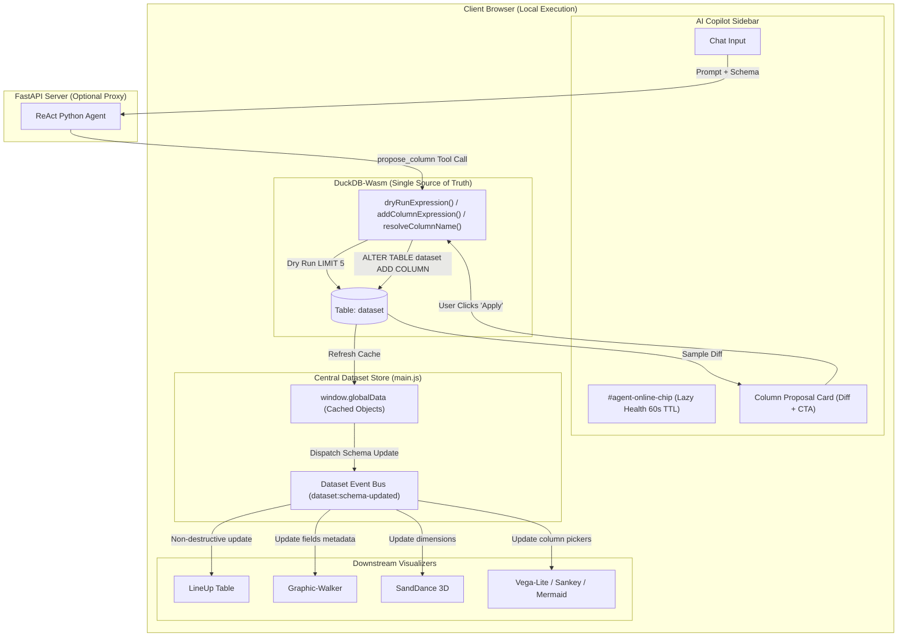
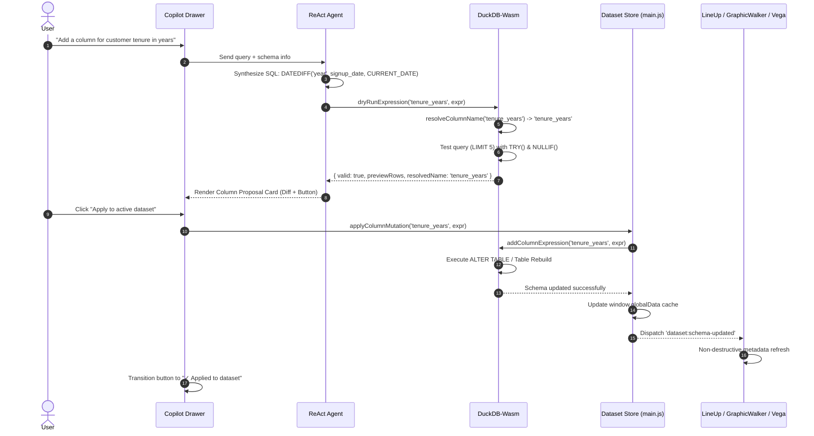

# DuckDB-Wasm Single Source of Truth & Streamlined AI Copilot UI

*   **Author:** Mats Schneider
*   **Status:** Proposed
*   **Date:** 2026-11-03

--------------------------------------------------------------------------------

## Overview

Dataviz-Agent enables users to explore and visualize complex datasets through high-density visualizers and an embedded ReAct AI agent. However, analytical state is currently fragmented across disparate layers: in-memory JavaScript arrays, DuckDB-Wasm instances, and ephemeral Pandas DataFrames on the backend. This fragmentation prevents agent-generated transformations—such as calculated metrics or appended columns—from persisting into the active dataset or updating downstream visualizers.

This design establishes client-side DuckDB-Wasm as the authoritative Single Source of Truth (SSOT). All dataset mutations flow through deterministic SQL expressions and require explicit user consent via an interactive "Apply to active dataset" confirmation gate. Concurrently, the AI Copilot user interface is overhauled to eliminate visual redundancies, streamline session management with distinct iconography, and elevate drawer navigation.

## The Problem

1. **State Fragmentation & Ephemeral Computations:** When the AI Copilot executes code to compute a new field (e.g., normalizing a column or calculating a ratio), the computation runs on an isolated DataFrame copy in Python backend memory and is discarded. The application's core dataset is never updated, leaving visualizers (LineUp, Graphic-Walker, SandDance, Vega-Lite, Sankey, Mermaid) disconnected from agent insights.
2. **Lack of User Governance over Dataset Schema:** Uncontrolled automatic mutations risk corrupting user data and invalidating existing visual encodings. Users lack a clear preview diff and an explicit confirmation gate before calculated columns are committed.
3. **UI Redundancy & Ergonomic Friction:** Connection health is redundantly stated in the top Copilot header and the chat welcome message. Action buttons for session history and new conversations rely on ambiguous icons (clock and plus), while the panel close button (`X`) crowds session actions despite closing already being handled by the primary navigation bar.

## Goals

*   **DuckDB-Wasm Single Source of Truth:** Centralize dataset ingestion, schema tracking, and querying inside DuckDB-Wasm, deprecating disconnected in-memory JavaScript object copies as the authority.
*   **Explicit Confirmation Gate:** Provide an interactive proposal card in chat displaying the proposed column name, data type, SQL formula, and a 3-row diff preview with an `Apply to active dataset` action button.
*   **Reactive Visualizer Propagation:** Propagate confirmed column additions across all downstream tools (LineUp, Graphic-Walker, SandDance, Vega-Lite, Sankey, Mermaid) using non-destructive metadata updates where available.
*   **Defensive SQL Execution:** Automatically protect division operations with `NULLIF()` and validate expressions with `TRY()` during sample dry-runs before exposing the confirmation button.
*   **Automatic Collision Resolution:** Automatically resolve column name collisions by appending an incrementing numerical suffix (`<name>_1`).
*   **Copilot UI De-noising:** Remove the redundant drawer close button (`X`), restrict connection health to an ambient top header chip evaluated on drawer open, display only the active model in the welcome card, and introduce distinct iconography for new chat (`fa-pen-to-square`) and session history (`fa-message`).

## Non-Goals

*   **Server-Side In-Memory Pandas Mutation:** Streaming full DataFrame copies back and forth over JSON between FastAPI and the browser. All persistent transformations must compile to client-executable DuckDB SQL expressions.
*   **Multi-Table Relational Joins:** Supporting multi-file schemas or relational foreign key management. The schema remains a single wide table (`dataset`).
*   **Destructive Column Deletion via Chat:** Supporting automated deletion or dropping of existing columns via conversational prompts in this phase.
*   **Continuous Background Health Pinging:** Periodically pinging LLM endpoints in the background when the Copilot drawer is closed.

## Open Questions

*   None currently identified; all primary architectural questions (SSOT engine, confirmation flow, collision resolution, and UI layout) were resolved during brainstorming.

## Critical User Journeys (CUJs)

### CUJ 1: Agent-Assisted Column Addition
*   **Given**: A dataset with `revenue` and `cost` columns loaded into the application.
*   **When**: The user prompts the Copilot: "Add a profit margin column as a percentage".
*   **Then**: The agent generates a safe SQL expression `((revenue - cost) / NULLIF(revenue, 0)) * 100`, validates it on a 5-row dry run, and renders a proposal card with a preview diff. The user clicks "Apply to active dataset". The column `profit_margin` is added to DuckDB, the card transitions to "✓ Applied to dataset", and the new column immediately appears in LineUp, Graphic-Walker shelves, and Vega dimension pickers.

### CUJ 2: Column Collision Auto-Increment
*   **Given**: An active dataset that already contains a column named `status`.
*   **When**: The user prompts the Copilot to create a category column called `status`.
*   **Then**: The system detects the collision, updates the proposal to `status_1`, notes the auto-increment in the preview card, and applies `status_1` upon user confirmation without DuckDB schema errors.

### CUJ 3: Streamlined Copilot Experience
*   **Given**: The application is open with the Copilot drawer closed.
*   **When**: The user clicks the navbar `Agent` button to open the drawer.
*   **Then**: Connection health is evaluated once and reflected in the top header chip (`Ready` / `Offline`). The welcome message cleanly displays the active model name without redundant "Ready" badges. The header displays dedicated `New Chat` (`fa-pen-to-square`) and `History` (`fa-message`) buttons, and panel closing is executed cleanly via the navbar toggle.

--------------------------------------------------------------------------------

## Technical Plan (Architecture)

### 1. High-Level Architecture

The architecture transitions from fragmented, disconnected data copies to a reactive, DuckDB-anchored model where mutations follow a strict unidirectional pipeline:

### 2. Component Boundaries & Responsibilities

#### A. Columnar Engine (`static/js/duckdb-engine.js`)
*   **`resolveColumnName(targetName: string): Promise<string>`**:
    Queries existing column names via `PRAGMA table_info('dataset')`. If `targetName` exists (case-insensitively), recursively appends an auto-incrementing numerical suffix (`<targetName>_1`, `<targetName>_2`) until a distinct identifier is found.
*   **`dryRunExpression(columnName: string, sqlExpression: string): Promise<{ valid: boolean, previewRows?: object[], error?: string, resolvedName: string }>`**:
    Wraps the SQL expression with defensive guardrails:
    1. Division operators `/` are wrapped to `NULLIF(<denominator>, 0)`.
    2. Syntax is tested on a limited projection: `SELECT *, TRY(${sanitizedExpr}) AS "${resolvedName}" FROM dataset LIMIT 5;`.
    Returns sample records for UI diff rendering without modifying the table.
*   **`addColumnExpression(columnName: string, sqlExpression: string): Promise<void>`**:
    Executes the persistent schema change:
    `ALTER TABLE dataset ADD COLUMN "${columnName}" AS (${sanitizedExpr});` or reconstructs the table via `CREATE OR REPLACE TABLE dataset AS SELECT *, ${sanitizedExpr} AS "${columnName}" FROM dataset;` to ensure physical persistence and cross-engine serialization.

#### B. Agent Tool & Interactive Proposal Card (`static/js/agent.js`, `static/js/browser-agent.js`)
*   **`propose_column` ReAct Tool**:
    The agent receives dataset schema and metadata. When an analytical query implies a calculated field, it invokes `propose_column(column_name, sql_expression, description)`.
*   **Proposal Card Rendering**:
    In `renderMessage()`, the response generates an interactive card containing:
    1. Header: Proposed column name, badge with inferred type (`FLOAT`, `BIGINT`, `VARCHAR`), and collision note if renamed.
    2. SQL formula in a syntax pill.
    3. 3-row diff mini-table showing primary key / index columns alongside newly calculated values.
    4. Button: `<button class="button primary apply-column-btn" data-col="${name}" data-expr="${expr}"><i class="fa-solid fa-table-columns"></i> Apply to active dataset</button>`.
*   **Confirmation Handler**:
    Clicking the button calls `window.datasetStore.applyColumnMutation(name, expr)`. Upon completion, the button transitions to a disabled state with `<i class="fa-solid fa-check"></i> Applied to dataset`.

#### C. Central Dataset Store & Event Dispatcher (`static/main.js`)
*   Manages the authoritative dataset lifecycle.
*   Exposes `window.datasetStore = { applyColumnMutation, getSnapshot, subscribe }`.
*   Dispatches custom DOM event `dataset:schema-updated` with detail `{ columnName, newColumns, totalRows }`.
*   Provides non-destructive adapter hooks:
    *   **LineUp**: Calls `lineUpInstance.data.pushDesc()` or refreshes column descriptions without clearing rankings or sorting.
    *   **Graphic-Walker**: Triggers metadata refresh for dimension/measure shelves without resetting active chart specifications or unmounting React roots.
    *   **Vega & Custom Charts**: Updates dropdown dimension selectors dynamically.

#### D. Streamlined Copilot Header UI (`static/index.html`, `static/style.css`)
*   **Panel Close Button Removal**: Remove `#agent-copilot-collapse-btn` from `.copilot-header-actions`. The navbar `#show-agent-btn` (and shortcut `⌘J`) serves as the sole toggle.
*   **Iconography Disambiguation**:
    *   `#chat-clear-btn`: Changed to `<i class="fa-solid fa-pen-to-square"></i>` with tooltip `"New conversation"`.
    *   `#chat-history-btn`: Changed to `<i class="fa-solid fa-message"></i>` with tooltip `"Previous conversations"`.
*   **Lazy Health Evaluation**:
    *   `AgentManager.checkStatus()` is invoked upon opening the sidebar via `#show-agent-btn` rather than continuous background loops.
    *   Cached with a 60-second TTL to eliminate redundant `/validate_key` requests during rapid open/close cycles.
    *   Status is displayed strictly on `#agent-online-chip` in the top header (`Ready` / `Offline`).
    *   The chat welcome card renders only the model name (`inception/mercury-2.5`) with no status duplicate.

### 3. Sequence Flow: Propose & Apply Column

--------------------------------------------------------------------------------

## Alternatives Considered

### Alternative 1: Server-Side Pandas Mutation with Full Array Re-Download
*   **Description**: Allow Python code in the FastAPI backend (`execute_python_code`) to mutate `self.df` directly, convert the updated DataFrame to a complete JSON array, and stream it back over HTTP to replace the browser's data.
*   **Pros**:
    *   Leverages arbitrary Python data transformation libraries (NumPy, SciPy, Pandas string methods).
    *   Familiar syntax for data science users without needing SQL compilation.
*   **Cons**:
    *   Serializing large datasets (50,000+ rows) over JSON creates severe network transfer latency and UI freezing during parsing.
    *   Breaks offline and local-first execution paradigms (direct browser mode).
    *   Introduces split-brain synchronization problems between client DuckDB-Wasm and server memory.
*   **Reason for Rejection**: Rejected by author: Massive network transfer lag, destruction of offline/local-first capabilities, and split-brain sync conflicts.

### Alternative 2: Immediate / Silent Column Mutation
*   **Description**: Whenever the AI agent determines that a calculated metric or transformed column is needed to satisfy a user request, it automatically executes the DuckDB schema change without user intervention.
*   **Pros**:
    *   Eliminates an extra click for the user.
    *   Feels faster and more autonomous for simple queries.
*   **Cons**:
    *   Destroys user trust by mutating data unexpectedly.
    *   Risks polluting schemas with intermediate or throwaway variables.
    *   Can trigger unexpected visual re-layouts in active chart views (Graphic-Walker or LineUp).
*   **Reason for Rejection**: Rejected by author: Schema integrity requires strict governance. An explicit confirmation step ("Apply to active dataset") is mandatory to prevent accidental pollution and layout disruption.

### Alternative 3: Retaining Dedicated Close Button Inside Copilot Header
*   **Description**: Keep a dedicated close button (`X`) inside the Copilot drawer header alongside session management buttons.
*   **Pros**:
    *   Provides an in-panel dismissal target standard in modal dialogs.
*   **Cons**:
    *   Creates functional redundancy with the navbar `Agent` toggle button situated directly nearby.
    *   Increases visual clutter in a narrow drawer header.
    *   Causes frequent accidental dismissals due to proximity to the New Conversation button.
*   **Reason for Rejection**: Rejected by author: Having two close controls in close proximity creates visual redundancy and misclicks. The navbar toggle is the established standard across the application for opening and closing side panels.

--------------------------------------------------------------------------------

## Detailed Implementation Plan

This section provides the unified, actionable execution plan for implementing the DuckDB-Wasm Single Source of Truth and the streamlined AI Copilot UI.

### 1. Touched Files & Modules

| File Path | Action | Rationale |
| :--- | :--- | :--- |
| `static/js/duckdb-engine.js` | Modify | Implement schema inspection (`resolveColumnName`), defensive expression dry-running (`dryRunExpression` with `NULLIF` and `TRY`), and persistent column addition (`addColumnExpression`). |
| `static/main.js` | Modify | Introduce central `window.datasetStore` mediator, register the `dataset:schema-updated` event dispatcher, wire non-destructive visualizer refreshes, and bind lazy health checks on `#show-agent-btn` toggle. Remove listener for deleted collapse button. |
| `static/js/agent.js` | Modify | Clean up welcome message badge (strip "Ready" and server tags), implement 60s TTL lazy health check updating `#agent-online-chip`, define `propose_column` tool, render the interactive Column Proposal Card, and handle the "Apply to active dataset" confirmation event. |
| `static/js/browser-agent.js` | Modify | Handle browser-direct execution of the `propose_column` tool via `duckdbEngine.dryRunExpression()`. |
| `static/index.html` | Modify | Remove `#agent-copilot-collapse-btn` (`fa-xmark`), update `#chat-clear-btn` icon to `fa-pen-to-square`, update `#chat-history-btn` icon to `fa-message`, and ensure `#agent-online-chip` is styled as the sole header health badge. |
| `static/style.css` | Modify | Add styles for `.column-proposal-card`, `.proposal-diff-table`, formula code pills, `.apply-column-btn`, and applied confirmation badge states. Remove obsolete styles for panel collapse button. |
| `tests/test_agent.py` | Modify | Add unit tests verifying `propose_column` tool schema definition, safe SQL sanitization (`NULLIF`, `TRY`), and auto-increment naming logic. |

---

### 2. Step-by-Step Execution Sequence

#### Step 2.1: DuckDB-Wasm Schema Mutation Engine (`static/js/duckdb-engine.js`)
1.  **Column Collision Resolver**:
    *   Implement `resolveColumnName(baseName)`: Query table column names from `dataset`. If `baseName` exists (case-insensitive check), iterate counter starting at 1 (`${baseName}_1`, `${baseName}_2`) until an unused name is located.
2.  **Defensive Dry-Run Engine**:
    *   Implement `dryRunExpression(columnName, sqlExpr)`:
        *   Sanitize arithmetic: automatically replace `/ <term>` patterns with `/ NULLIF(<term>, 0)`.
        *   Resolve column name via `resolveColumnName(columnName)`.
        *   Execute test projection query: `SELECT *, TRY(${sanitizedExpr}) AS "${resolvedName}" FROM dataset LIMIT 5;`.
        *   Return structured payload: `{ valid: true, previewRows, resolvedName, sanitizedExpr, wasRenamed: (resolvedName !== columnName) }`. If an error occurs, catch it and return `{ valid: false, error: err.message }`.
3.  **Physical Column Addition**:
    *   Implement `addColumnExpression(columnName, sqlExpr)`:
        *   Execute `CREATE OR REPLACE TABLE dataset AS SELECT *, ${sqlExpr} AS "${columnName}" FROM dataset;` (preferred over `ALTER TABLE` to ensure full column persistence, type inference, and Arrow export reliability in WebAssembly).

#### Step 2.2: Central Dataset Store & Event Dispatcher (`static/main.js`)
1.  **Define `window.datasetStore`**:
    *   Provide methods:
        *   `applyColumnMutation(columnName, sqlExpr)`: Invokes `duckdbEngine.addColumnExpression(columnName, sqlExpr)`, retrieves fresh records via `tableToObjects()`, updates `window.globalData`, and dispatches `dataset:schema-updated`.
        *   `getSnapshot()`: Returns the latest cached dataset records.
        *   `subscribe(eventName, callback)`: Helper wrapper around window event listeners.
2.  **Downstream Visualizer Adapters (`dataset:schema-updated`)**:
    *   **LineUp**: Call `lineUpInstance.data.pushDesc()` or update column descriptions without rebuilding the full hierarchy to preserve active column positions and sorts.
    *   **Graphic-Walker**: Call the component's internal field list updater or pass updated `fields` prop to refresh dimension/measure shelves without resetting user-placed visual encodings.
    *   **Vega / Custom Charts**: Re-populate dimension dropdown selectors (`#vega-x-axis`, `#vega-y-axis`, Sankey column pickers).
    *   **Live Data State Drawer**: Re-render the bottom 5-row preview table with the newly appended column.
3.  **Drawer Toggle Authority**:
    *   Remove event listeners referencing `#agent-copilot-collapse-btn`.
    *   In the `#show-agent-btn` click handler: if opening the drawer, trigger `agentMgr.checkStatusLazy()`.

#### Step 2.3: Streamlined Header & Iconography (`static/index.html` & `static/style.css`)
1.  **Markup Cleanup**:
    *   Delete `<button id="agent-copilot-collapse-btn">...</button>` from `.copilot-header-actions`.
    *   Update `#chat-clear-btn` inner HTML to `<i class="fa-solid fa-pen-to-square"></i>` with `title="New conversation"`.
    *   Update `#chat-history-btn` inner HTML to `<i class="fa-solid fa-message"></i>` with `title="Previous conversations"`.
2.  **Style Rules**:
    *   Ensure `.copilot-status-chip` displays cleanly in the header with animated pulse dot for connecting, green for ready, and amber/red for error.
    *   Add styling for `.column-proposal-card`: border highlight, syntax pill for formula, diff table with zebra striping, and `.apply-column-btn` hover/disabled states.

#### Step 2.4: Agent Proposal Tool & Confirmation Card (`static/js/agent.js` & `static/js/browser-agent.js`)
1.  **UI Redundancy Elimination**:
    *   In `getWelcomeMessageHtml()`: Remove `Ready · ` and `(Server)` / `(Direct)` prefixes. Format `modelBadge` to show strictly `this.activeModel || 'LLM Agent'`.
    *   In `checkStatusLazy()`: Check timestamp against an in-memory variable `lastHealthCheckTime`. If less than 60 seconds have elapsed, return cached state. Otherwise, perform validation and update `#agent-online-chip` text and CSS classes.
2.  **`propose_column` Tool Registration**:
    *   Add tool declaration to OpenAI tool schemas and system prompt:
        *   Parameters: `column_name` (string), `sql_expression` (string), `description` (string).
3.  **Tool Execution Flow**:
    *   When the agent invokes `propose_column`, execute `duckdbEngine.dryRunExpression(column_name, sql_expression)`.
    *   If validation succeeds, format the result into a structured proposal object and append a proposal block to the assistant's message.
4.  **Proposal Card Rendering**:
    *   In message rendering pipeline, construct the HTML card:
        *   Header with column name and type pill.
        *   Code container with formula: `SQL: ${sanitizedExpr}`.
        *   Mini preview table of the 3 sample rows.
        *   Action button: `<button class="button primary apply-column-btn" data-col="${resolvedName}" data-expr="${sanitizedExpr}"><i class="fa-solid fa-table-columns"></i> Apply to active dataset</button>`.
5.  **Confirmation Event Listener**:
    *   Bind delegated click listener on `.apply-column-btn`.
    *   When clicked:
        *   Disable button and show spinner: `<i class="fa-solid fa-spinner fa-spin"></i> Applying...`.
        *   Invoke `window.datasetStore.applyColumnMutation(colName, expr)`.
        *   On success, transition button to `<button class="button applied" disabled><i class="fa-solid fa-check"></i> Applied to dataset</button>` and render brief confirmation text.

#### Step 2.5: Automated Testing (`tests/test_agent.py`)
1.  **Tool Schema Validation**: Test that `propose_column` is included in `AVAILABLE_TOOLS` / `OPENAI_TOOLS` and accepts the specified JSON schema.
2.  **Formula Sanitization**: Verify unit tests for arithmetic division wrapping with `NULLIF(..., 0)` to guarantee zero-divide safety.
3.  **Regression Check**: Ensure existing chat completion, Vega generation, and code execution endpoints continue to pass without regression.
